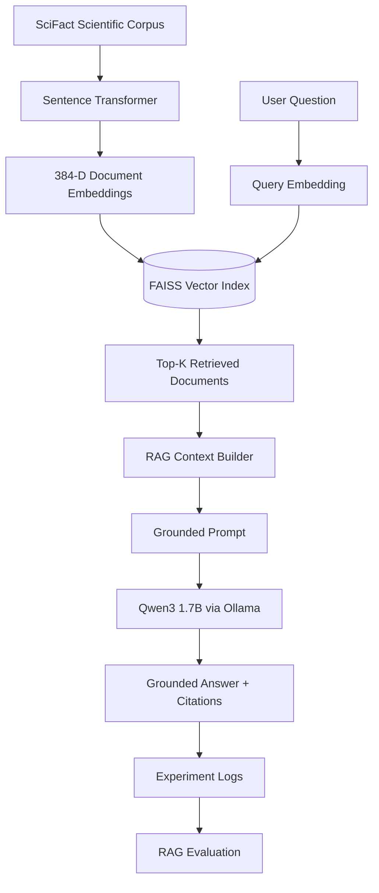

# Scalable RAG with Apache Spark

A research-oriented project exploring **Retrieval-Augmented Generation (RAG) over increasingly large document collections**, progressing from local semantic retrieval and local LLM generation toward scalable and optimized AI-powered data systems using Apache Spark.

The project is developed incrementally so that **retrieval quality, groundedness, generation quality, latency, context size, and scalability** can be measured at each stage.

> **Current status:** V3 completed — semantic retrieval, local end-to-end RAG, and systematic evaluation of retrieval depth, groundedness, citation faithfulness, latency, and context size.

---

# Project Motivation

Retrieval-Augmented Generation combines information retrieval with Large Language Models (LLMs) so that generated answers can be grounded in external evidence.

A conventional RAG pipeline follows:

```text
Documents
    ↓
Embeddings
    ↓
Vector Index
    ↓
Retrieval
    ↓
Retrieved Context
    ↓
LLM
    ↓
Grounded Answer
```

This project investigates a broader systems-oriented question:

> **How can RAG pipelines be designed, evaluated, optimized, and scaled as document collections grow from thousands to millions of documents?**

The project begins with a reproducible local baseline and progressively introduces:

- semantic retrieval
- local LLM generation
- RAG evaluation
- groundedness analysis
- adaptive retrieval
- larger datasets
- distributed processing
- Apache Spark
- multi-objective and evolutionary optimization

---

# Current Architecture



The current implementation runs completely locally and does not require a paid LLM API.

---

# Project Evolution

## V1.0 — Semantic Retrieval Baseline

V1 established the retrieval component independently of an LLM.

### Pipeline

```text
SciFact
   ↓
all-MiniLM-L6-v2
   ↓
384-dimensional embeddings
   ↓
FAISS
   ↓
Top-K semantic retrieval
   ↓
Recall@K evaluation
```

### Dataset

The initial benchmark uses **SciFact**.

Current dataset statistics:

| Item | Count |
|---|---:|
| Corpus documents | 5,183 |
| Queries loaded | 1,109 |
| Queries evaluated in baseline | 300 |

SciFact provides relevance judgments, allowing retrieval effectiveness to be measured quantitatively.

### Embedding Model

V1 uses:

```text
sentence-transformers/all-MiniLM-L6-v2
```

Each document is represented as a:

```text
384-dimensional dense vector
```

### Vector Search

Document embeddings are indexed using **FAISS**.

Queries are embedded using the same Sentence Transformer model and compared with document vectors using dense semantic similarity.

### V1 Baseline

| Metric | Result |
|---|---:|
| Documents indexed | 5,183 |
| Embedding dimension | 384 |
| Queries evaluated | 300 |
| Top-K | 5 |
| **Recall@5** | **0.7533** |

A Recall@5 of `0.7533` means that for approximately **75.3% of evaluated queries**, at least one known relevant SciFact document appeared among the five retrieved documents.

This measures retrieval effectiveness, not final RAG answer quality.

### Initial Indexing Observation

On the initial CPU-based development machine, embedding and indexing the 5,183-document SciFact corpus took approximately:

```text
7 minutes 54 seconds
```

This provides an initial performance baseline for future scalability experiments.

---

# V2.0 — Local Retrieval-Augmented Generation

V2 extends the V1 retriever into a complete local RAG pipeline.

### V2 Pipeline

```text
Question
   ↓
Query Embedding
   ↓
FAISS Retrieval
   ↓
Top-K Scientific Documents
   ↓
Context Construction
   ↓
Grounded Prompt
   ↓
Local LLM
   ↓
Answer + Citations
```

### Local LLM

V2 uses:

```text
Qwen3 1.7B
```

served locally through:

```text
Ollama
```

This allows the complete RAG pipeline to run without a paid hosted LLM API.

The LLM is responsible for **generation**.

Retrieval remains a separate component:

```text
Sentence Transformer + FAISS
```

This separation makes it possible to independently evaluate retrieval and generation.

---

## Grounding Strategy

Retrieved documents are converted into numbered evidence blocks:

```text
[1]
Document ID: ...
Title: ...
Evidence: ...

[2]
Document ID: ...
Title: ...
Evidence: ...
```

The generator is instructed to:

1. answer using only retrieved evidence
2. avoid unsupported claims
3. cite evidence using `[1]`, `[2]`, etc.
4. explicitly report when retrieved evidence is insufficient
5. provide a concise answer and explanation

---

## Example V2 Query

### Question

```text
Does vitamin D reduce the risk of multiple sclerosis?
```

The highest-ranked retrieved document was:

```text
Vitamin D and latitude as environmental factors in multiple sclerosis
```

with similarity:

```text
0.7421
```

The local Qwen3 model generated an evidence-based response with numbered citations and appropriately expressed uncertainty about establishing a direct causal relationship.

### Initial Generation Performance

| Component | Result |
|---|---:|
| LLM | Qwen3 1.7B |
| Runtime | Ollama |
| Hardware | Local CPU |
| Top-K | 5 |
| Generation time | **84.31 seconds** |

This latency measurement provides a baseline for future model, hardware, and scalability comparisons.

---

# V3.0 — RAG Evaluation & Retrieval Experiments

V3 moves beyond building the RAG pipeline and systematically evaluates how **retrieval depth (Top-K)** affects retrieval effectiveness and downstream RAG behavior.

The central research question is:

> **Does retrieving more documents necessarily produce better RAG answers?**

The experiments demonstrate that higher retrieval recall does **not** automatically translate into higher end-to-end RAG quality.

---

## Experiment 1 — Retrieval Depth

Retrieval was evaluated on 300 SciFact queries using:

```text
K = {1, 3, 5, 10, 20}
```

### Results

| K | Recall@K | Evaluation Time |
|---:|---:|---:|
| 1 | 0.5033 | 6.39 s |
| 3 | 0.6833 | 6.25 s |
| 5 | 0.7533 | 6.16 s |
| 10 | 0.7933 | 6.12 s |
| 20 | **0.8467** | 6.19 s |

As expected:

```text
K ↑ → Recall@K ↑
```

However, Recall@K measures whether relevant evidence is retrieved.

It does not measure whether the LLM successfully identifies and uses that evidence.

---

# Experiment 2 — Initial RAG Top-K Pilot

A five-query pilot evaluated:

```text
K = {1, 3, 5, 10}
```

producing:

```text
5 queries × 4 K values = 20 RAG runs
```

For each run, the experiment recorded:

- query ID
- K
- relevant-document retrieval
- first relevant-document rank
- retrieval scores
- context size
- generation latency
- citations
- generated answer

### Pilot Results

| K | Relevant Evidence Retrieved | Avg. Context | Avg. Generation Time | Avg. Citations |
|---:|---:|---:|---:|---:|
| 1 | 0.40 | 1,361 | 24.81 s | 0.8 |
| 3 | 0.60 | 4,051 | 38.10 s | 1.4 |
| 5 | **1.00** | 6,549 | 43.07 s | 1.4 |
| 10 | **1.00** | 14,438 | **91.71 s** | 0.8 |

The pilot showed that citation presence alone does not guarantee that the cited evidence actually supports the generated claim.

This motivated explicit groundedness evaluation.

---

# Experiment 3 — Groundedness & Citation Evaluation

V3 introduces human-style evaluation of generated answers.

## Groundedness

```text
2 = substantive claims directly supported by retrieved evidence

1 = partially supported or stronger than the available evidence

0 = central answer unsupported, contradictory, or off-topic
```

Scores are normalized to the range:

```text
0–1
```

## Citation Faithfulness

```text
2 = cited evidence directly supports the associated claim

1 = cited evidence provides partial or indirect support

0 = citation does not support the claim
```

## Citation Validity

```text
1 = citation refers to an actual retrieved document

0 = citation refers to an invalid/nonexistent document
```

Citation validity and citation faithfulness are deliberately treated as different concepts.

A citation can be syntactically valid while failing to support the claim attributed to it.

## Abstention Correctness

```text
1 = model appropriately answers when evidence is sufficient
    or appropriately reports insufficient evidence

0 = model confidently answers despite insufficient evidence
    or unnecessarily abstains despite adequate evidence
```

---

# Experiment 4 — Stratified RAG Evaluation

To more carefully study the relationship between retrieval and generation, V3 introduces a controlled **stratified RAG experiment**.

Queries were grouped according to the rank of their first known relevant document.

| Stratum | Relevant Document Rank | Interpretation |
|---|---|---|
| A | 1–3 | Evidence available at K=3 |
| B | 4–5 | Evidence first available at K=5 |
| C | 6–10 | Evidence first available at K=10 |
| D | Not retrieved in Top-10 | Evidence unavailable for tested K |

Five queries were selected from each stratum.

Therefore:

```text
4 strata × 5 queries = 20 queries
```

Each query was evaluated using:

```text
K = {3, 5, 10}
```

producing:

```text
20 queries × 3 retrieval depths = 60 RAG runs
```

Each run records:

- retrieval success
- retrieved evidence
- relevant-document rank
- context size
- generation latency
- generated citations
- generated answer
- groundedness
- citation faithfulness
- citation validity
- abstention behavior
- generation failures

---

# Overall V3 Results

| K | Evidence Retrieval* | Groundedness | Citation Faithfulness | Generation Failure | Avg. Generation Time | Avg. Context |
|---:|---:|---:|---:|---:|---:|---:|
| 3 | 0.25 | 0.475 | 0.4167 | 0.00 | 47.33 s | 4,252 |
| **5** | **0.50** | **0.525** | **0.4167** | **0.00** | **48.51 s** | **6,982** |
| 10 | 0.75 | 0.425 | 0.3750 | 0.15 | 120.84 s | 14,321 |

\*Evidence-retrieval rates in this table come from the intentionally stratified 20-query sample and are **not corpus-level Recall@K values**.

For the current experimental setup, **K=5 provides the strongest observed overall balance** between evidence coverage, groundedness, latency, and reliability.

---

# Key V3 Finding

Moving from:

```text
K=3 → K=5
```

increased evidence retrieval in the stratified sample:

```text
0.25 → 0.50
```

and increased groundedness:

```text
0.475 → 0.525
```

while average generation time changed only slightly:

```text
47.33 s → 48.51 s
```

However, moving to K=10 increased evidence retrieval while degrading several downstream metrics.

Average generation latency increased:

```text
48.51 s → 120.84 s
```

Average context size increased:

```text
6,982 → 14,321 characters
```

Groundedness decreased:

```text
0.525 → 0.425
```

and the generation failure rate increased to:

```text
15%
```

Therefore:

> **Maximizing retrieval recall does not necessarily maximize end-to-end RAG quality.**

---

# When Increasing K Helps

Stratum B was designed so that relevant evidence appears at ranks 4–5.

Therefore:

```text
K=3 → relevant evidence absent
K=5 → relevant evidence present
```

Observed groundedness:

```text
K=3 → 0.40
K=5 → 0.60
```

This demonstrates that increasing retrieval depth can improve RAG quality when the additional retrieval introduces genuinely useful evidence.

---

# When Increasing K Hurts

For Stratum A, relevant evidence is already present within the first three documents.

Results:

| K | Retrieval | Groundedness | Faithfulness | Failure | Avg. Time |
|---:|---:|---:|---:|---:|---:|
| 3 | 1.00 | **0.70** | **0.70** | 0.00 | 42.59 s |
| 5 | 1.00 | **0.70** | **0.70** | 0.00 | 49.23 s |
| 10 | 1.00 | 0.50 | 0.50 | 0.20 | 118.69 s |

Increasing K provides no retrieval benefit in this stratum because relevant evidence is already available.

However, K=10:

- reduces groundedness
- reduces citation faithfulness
- substantially increases latency
- introduces generation failures

This provides evidence of **context dilution or context pollution** for the current small local model.

---

# Retrieval Success Is Not Sufficient

Stratum C was designed so that relevant evidence first appears at ranks 6–10.

Therefore:

```text
K=5  → relevant evidence absent
K=10 → relevant evidence present
```

Yet groundedness remained:

```text
0.30 → 0.30
```

while average generation latency increased substantially.

This demonstrates an important distinction:

> **Retrieving relevant evidence is necessary in many cases, but it is not sufficient to guarantee that the generator will successfully use that evidence.**

---

# Toward Adaptive RAG

The V3 results raise a broader question:

> **Why should every query use the same K?**

Some queries may need only:

```text
K=3
```

while others may benefit from:

```text
K=5
```

and difficult queries may require deeper retrieval, reranking, or abstention.

Instead of:

```text
K = constant
```

future versions can investigate:

```text
K = f(
    query,
    retrieval scores,
    score gaps,
    retrieval confidence,
    evidence quality,
    context cost
)
```

Conceptually:

```text
Question
   ↓
Initial Retrieval
   ↓
Evidence sufficient?
   ├── Yes
   │    ↓
   │ Generate
   │
   └── No
        ↓
   Expand Retrieval
        ↓
   Rerank / Filter
        ↓
   Evidence sufficient?
        ├── Yes → Generate
        └── No  → Abstain
```

This provides the foundation for **adaptive retrieval**.

---

# Multi-Objective RAG Optimization

V3 also shows that RAG configuration naturally forms a multi-objective optimization problem.

Possible objectives include:

\[
\max \; Recall
\]

\[
\max \; Groundedness
\]

\[
\max \; CitationFaithfulness
\]

while simultaneously:

\[
\min \; GenerationLatency
\]

\[
\min \; ContextSize
\]

\[
\min \; GenerationFailures
\]

These objectives can conflict.

For example:

```text
Higher K
   ↓
Higher Recall
```

may also produce:

```text
Higher K
   ↓
Larger Context
   ↓
Higher Latency
   ↓
More Noise
   ↓
Lower Groundedness
```

This motivates future research using **evolutionary algorithms and multi-objective optimization** to identify efficient RAG configurations and adaptive retrieval policies.

Detailed V3 methodology, per-stratum results, limitations, and experimental artifacts are available in:

```text
docs/v3-experiments.md
```

---

# Technology Stack

| Component | Technology |
|---|---|
| Language | Python 3.11 |
| Dataset | SciFact |
| Embeddings | Sentence Transformers |
| Embedding model | all-MiniLM-L6-v2 |
| Embedding dimension | 384 |
| Vector index | FAISS |
| Local LLM runtime | Ollama |
| Generator | Qwen3 1.7B |
| Experiment logging | CSV / JSONL |
| RAG evaluation | Groundedness, citation faithfulness, abstention |
| Future distributed processing | Apache Spark / PySpark |
| Optimization direction | Evolutionary / multi-objective optimization |

---

# Repository Structure

```text
scalable-rag-spark/
│
├── README.md
├── LICENSE
├── requirements.txt
├── .env.example
├── .gitignore
│
├── data/
│   └── index/
│
├── docs/
│   ├── architecture.md
│   ├── rag-concepts.md
│   ├── rag-v2.md
│   ├── research-questions.md
│   └── v3-experiments.md
│
├── results/
│   ├── baseline_retrieval.txt
│   ├── experiments.csv
│   ├── rag_runs.jsonl
│   ├── topk_experiment.csv
│   ├── rag_topk_experiment.csv
│   ├── rag_topk_experiment.jsonl
│   ├── groundedness_summary.csv
│   ├── rag_stratified_queries.csv
│   ├── rag_stratified_experiment.csv
│   ├── rag_stratified_experiment.jsonl
│   ├── stratified_summary_by_k.csv
│   └── stratified_summary_by_group_k.csv
│
└── src/
    ├── config.py
    ├── load_scifact.py
    ├── build_index.py
    ├── retrieve.py
    ├── evaluate_retrieval.py
    ├── rag.py
    ├── evaluate_topk.py
    ├── evaluate_rag_topk.py
    ├── prepare_groundedness_evaluation.py
    ├── analyze_groundedness.py
    ├── evaluate_rag_stratified.py
    ├── prepare_stratified_groundedness.py
    └── analyze_stratified_groundedness.py
```

Generated vector-index files under `data/index/` are not intended to be committed to Git. They can be reproduced using the indexing pipeline.

---

# Running the Project

## 1. Create a Virtual Environment

Windows:

```powershell
py -3.11 -m venv .venv
& ".\.venv\Scripts\Activate.ps1"
```

Install dependencies:

```powershell
pip install -r requirements.txt
```

---

## 2. Load SciFact

```powershell
python src\load_scifact.py
```

Expected:

```text
Corpus documents: 5,183
Queries: 1,109
Qrels: 339
```

---

## 3. Build the FAISS Index

```powershell
python src\build_index.py
```

This generates document embeddings and builds the local FAISS index.

---

## 4. Test Semantic Retrieval

```powershell
python src\retrieve.py
```

Enter a scientific query when prompted.

---

## 5. Evaluate Baseline Retrieval

```powershell
python src\evaluate_retrieval.py
```

The initial baseline is:

```text
Recall@5 = 0.7533
```

---

# Running Local RAG

Install Ollama and verify:

```powershell
ollama --version
```

Pull the current model:

```powershell
ollama pull qwen3:1.7b
```

Verify:

```powershell
ollama list
```

---

## Configure the Project

Create a local `.env` based on:

```text
.env.example
```

For local generation:

```env
LLM_PROVIDER=ollama
OLLAMA_MODEL=qwen3:1.7b
OLLAMA_URL=http://localhost:11434
```

The `.env` file is excluded from Git and should never be committed.

---

## Run RAG

```powershell
python src\rag.py
```

The system will:

1. accept a question
2. embed the question
3. retrieve Top-K SciFact documents
4. construct the RAG context
5. send the grounded prompt to the local LLM
6. return an answer with citations
7. log the run

RAG runs are recorded under:

```text
results/
```

---

# Running V3 Experiments

## Recall@K

```powershell
python src\evaluate_topk.py
```

Evaluates:

```text
K = {1, 3, 5, 10, 20}
```

---

## RAG Top-K Pilot

```powershell
python src\evaluate_rag_topk.py
```

---

## Prepare Groundedness Evaluation

```powershell
python src\prepare_groundedness_evaluation.py
```

---

## Analyze Groundedness

```powershell
python src\analyze_groundedness.py
```

---

## Stratified RAG Experiment

```powershell
python src\evaluate_rag_stratified.py
```

---

## Prepare Stratified Evaluation

```powershell
python src\prepare_stratified_groundedness.py
```

---

## Analyze Stratified Results

```powershell
python src\analyze_stratified_groundedness.py
```

---

# Current Research Directions

V3 established retrieval-depth and groundedness baselines.

Current research directions include:

- adaptive Top-K retrieval
- retrieval-confidence estimation
- reranking
- hybrid retrieval
- alternative embedding models
- larger document collections
- generator comparison
- multi-objective RAG optimization
- evolutionary optimization of RAG configurations
- distributed RAG preprocessing with Apache Spark

---

# Scaling Roadmap

```text
V1  Semantic Retrieval                         ✅
        ↓
V2  Local End-to-End RAG                       ✅
        ↓
V3  RAG Evaluation & Top-K Experiments         ✅
        ↓
V4  Larger Corpus & Scalability                ← NEXT
        ↓
V5  Apache Spark / Distributed Processing
        ↓
V6  Million-Scale Retrieval Experiments
        ↓
V7  Adaptive & Evolutionary RAG Optimization
```

The objective is to introduce distributed infrastructure when the workload justifies it rather than adding Spark before it is needed.

---

# Research Questions

The broader project investigates questions such as:

- How does retrieval effectiveness change as corpus size increases?
- How do embedding and indexing costs scale with document volume?
- When does single-machine preprocessing become a bottleneck?
- How can Apache Spark improve RAG ingestion and embedding pipelines?
- How should large embedding collections be partitioned and indexed?
- What trade-offs exist between retrieval quality, latency, and context size?
- How does Top-K affect RAG groundedness and citation faithfulness?
- When does additional retrieved context help or hurt generation?
- Can retrieval confidence determine an adaptive K?
- How reliably do LLM citations correspond to retrieved evidence?
- How do local and hosted LLMs compare for RAG workloads?
- Can evolutionary algorithms optimize RAG configurations?
- What Pareto trade-offs exist among quality, latency, context size, and resource usage?

---

# Version History

## v1.0 — Semantic Retrieval

Completed:

- SciFact loading
- Sentence Transformer embeddings
- FAISS indexing
- semantic search
- Recall@K evaluation
- experiment logging

Baseline:

```text
Recall@5 = 0.7533
```

---

## v2.0 — Local RAG

Completed:

- context construction
- grounded prompting
- local LLM generation
- Ollama integration
- Qwen3 1.7B integration
- numbered source citations
- RAG run logging

Initial measured generation:

```text
84.31 seconds
```

on the initial CPU-only development machine.

---

## v3.0 — RAG Evaluation & Retrieval Experiments

Completed:

- Recall@K evaluation over 300 SciFact queries
- RAG Top-K pilot experiments
- groundedness evaluation
- citation-faithfulness evaluation
- abstention evaluation
- stratified retrieval experiment
- 60-run controlled RAG evaluation
- context-size measurement
- generation-latency measurement
- generation-failure analysis

Retrieval results:

```text
Recall@1  = 0.5033
Recall@3  = 0.6833
Recall@5  = 0.7533
Recall@10 = 0.7933
Recall@20 = 0.8467
```

In the controlled stratified RAG experiment, **K=5 provided the strongest observed balance** between retrieval coverage, groundedness, and generation cost.

The experiments also demonstrated that:

> **Higher retrieval recall does not necessarily produce better end-to-end RAG quality.**

---

# Future Direction — Larger-Scale RAG

V4 will begin increasing corpus size and measuring how the existing RAG architecture behaves as the workload grows.

The project will progressively evolve toward:

```text
Large Document Collection
          ↓
     Apache Spark
          ↓
Distributed Ingestion
          ↓
Distributed Preprocessing
          ↓
Distributed Chunking
          ↓
Embedding Generation
          ↓
Vector Index
          ↓
Retrieval
          ↓
Adaptive RAG
          ↓
LLM
```

Future scalability measurements will include:

- ingestion time
- preprocessing time
- embedding time
- index construction time
- index size
- retrieval latency
- memory consumption
- generation latency
- context size
- groundedness
- retrieval quality

The longer-term objective is not simply to build another RAG application.

It is to investigate:

> **Scalable and optimized AI-powered data systems for large document collections.**

---

# Future Direction — Evolutionary Optimization

The V3 experiments show that RAG configuration involves competing objectives.

Future research will investigate evolutionary and multi-objective optimization of variables such as:

- retrieval depth
- chunk size
- chunk overlap
- embedding configuration
- retrieval thresholds
- reranking parameters
- context size
- Spark configuration
- resource allocation

Potential objectives include:

```text
maximize:
    retrieval quality
    groundedness
    citation faithfulness

minimize:
    latency
    context size
    resource usage
    generation failures
```

This provides a foundation for future research on:

- adaptive RAG
- evolutionary RAG optimization
- Pareto-optimal RAG configurations
- distributed RAG optimization
- resource-aware AI systems

---

# Project Context

This project is part of **Big Data & AI Systems**, a collection of research and open-source projects exploring:

- Big Data
- distributed data processing
- cloud computing
- data engineering
- AI-powered data systems
- Retrieval-Augmented Generation
- vector search
- LLM-powered analytics
- optimization of AI and data systems

Organization:

**https://github.com/BigDataAISystems**

---

# Author

**Mahdi Ebrahimi, Ph.D.**  
Associate Professor of Computer Science  
California State University, Northridge (CSUN)

Research interests include **Big Data, large-scale data systems, cloud computing, distributed data processing, optimization, and AI-powered data systems**.

Academic website:

**https://mebrahimii.github.io**

---

# License

This project is released under the **MIT License**.

See:

```text
LICENSE
```

for details.