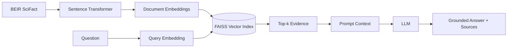

# Scalable RAG with Apache Spark

A research-oriented **Retrieval-Augmented Generation (RAG)** project that progresses from a transparent local baseline to scalable Big Data pipelines with **Apache Spark**.

> **Current milestone: V1 — Local RAG baseline with BEIR SciFact, Sentence Transformers, FAISS, and optional LLM generation.** Spark is intentionally introduced later so its scalability benefit can be measured against a non-distributed baseline.

## Why this project?

Many RAG demos work with a handful of PDFs. This project asks a systems-oriented question:

> How should ingestion, embedding, indexing, retrieval, and updates evolve as a RAG corpus grows from thousands to millions of passages?

The project is designed to connect **Big Data and distributed data processing** with modern **AI-powered data systems**.

## Roadmap

| Version | Dataset / Scale | Main goal |
|---|---|---|
| V1 | BEIR SciFact (~small benchmark) | Understand and implement RAG end to end |
| V2 | SciFact | Retrieval evaluation and RAG experiments |
| V3 | BEIR TREC-COVID | Intermediate-scale retrieval |
| V4 | TREC-COVID / MS MARCO subset | Introduce local Apache Spark |
| V5 | MS MARCO 100K–1M passages | Scalable preprocessing and embedding experiments |
| V6 | Full MS MARCO | Distributed-scale experiments |
| V7 | Databricks / cluster | Production-oriented distributed pipeline |

## V1 Architecture



## What V1 teaches

- What an embedding is and how text becomes a vector
- Dense semantic retrieval
- Cosine similarity using normalized embeddings
- Vector indexing with FAISS
- Top-k evidence retrieval
- Context construction
- Retrieval-Augmented Generation
- Grounding answers in retrieved evidence
- Retrieval evaluation using relevance judgments

No LangChain is used in V1. The individual RAG components remain visible and inspectable.

## Technology Stack

- Python
- Hugging Face Datasets
- Sentence Transformers
- FAISS
- NumPy / Pandas
- OpenAI API (optional for generation)
- Apache Spark / PySpark (planned milestones)

## Repository Structure

```text
scalable-rag-spark/
├── README.md
├── requirements.txt
├── .env.example
├── data/
│   └── README.md
├── docs/
│   ├── architecture.md
│   └── research-questions.md
├── experiments/
├── results/
└── src/
    ├── config.py
    ├── load_scifact.py
    ├── build_index.py
    ├── retrieve.py
    ├── rag.py
    └── evaluate_retrieval.py
```

## Windows Setup

### 1. Clone

```powershell
git clone https://github.com/BigDataAISystems/scalable-rag-spark.git
cd scalable-rag-spark
```

### 2. Create a virtual environment

```powershell
python -m venv .venv
.venv\Scripts\Activate.ps1
```

If PowerShell blocks activation, use Command Prompt:

```cmd
.venv\Scripts\activate.bat
```

### 3. Install dependencies

```powershell
python -m pip install --upgrade pip
pip install -r requirements.txt
```

### 4. Check the dataset

```powershell
python src/load_scifact.py
```

### 5. Build the FAISS index

```powershell
python src/build_index.py
```

The embedding model is downloaded automatically on first use. Generated index files are stored under `data/index/` and are not committed to Git.

### 6. Try retrieval

```powershell
python src/retrieve.py
```

Enter a scientific question or claim and inspect the top retrieved documents and similarity scores.

### 7. Evaluate retrieval

```powershell
python src/evaluate_retrieval.py
```

V1 reports a simple Recall@5 measure: the fraction of evaluated queries for which at least one known relevant document appears in the top five retrieved results.

### 8. Optional: generate a RAG answer

Retrieval works without a paid LLM API. To add generated answers, copy the environment template:

```powershell
copy .env.example .env
```

Add your API key to `.env`, then run:

```powershell
python src/rag.py
```

The prompt instructs the model to answer only from retrieved evidence and to cite source numbers.

## Dataset Strategy

The project deliberately increases scale over time:

1. **SciFact** — small, scientifically oriented benchmark with relevance judgments
2. **TREC-COVID** — intermediate scientific retrieval benchmark
3. **MS MARCO** — millions of passages for large-scale experiments

This allows the project to measure when a conventional local pipeline stops being sufficient and when distributed processing becomes useful.

## Planned Experiments

- Corpus size vs. indexing time
- Corpus size vs. retrieval latency
- Embedding throughput
- Batch-size effects
- Retrieval Recall@k / nDCG@k
- Chunk-size and overlap experiments when long documents are introduced
- Spark vs. single-machine preprocessing
- Partitioning strategies
- Incremental corpus updates
- End-to-end RAG latency and cost

See [`docs/research-questions.md`](docs/research-questions.md).

## Project Status

- [x] V1 repository scaffold
- [x] SciFact loader
- [x] Sentence Transformer embedding pipeline
- [x] FAISS vector index
- [x] Dense retrieval
- [x] Minimal RAG generation path
- [x] Initial retrieval evaluation
- [ ] Validate V1 end to end on Windows
- [ ] Add stronger IR metrics (MRR, nDCG, Recall@k)
- [ ] Add experiment logging
- [ ] Add TREC-COVID
- [ ] Add PySpark pipeline
- [ ] Add MS MARCO scale experiments
- [ ] Add distributed deployment

## Research Direction

A straightforward RAG implementation is not itself a research contribution. The longer-term research focus is on **scalability, distributed data processing, ingestion/update strategies, retrieval effectiveness, latency, and cost trade-offs** for large RAG corpora.

## Organization

This project is part of **[Big Data & AI Systems](https://github.com/BigDataAISystems)**, an open-source project organization focused on Big Data, distributed processing, cloud computing, and AI-powered data systems.

## Author

**Mahdi Ebrahimi, Ph.D.**  
Associate Professor of Computer Science  
California State University, Northridge (CSUN)  

Academic website: https://mebrahimii.github.io/

## License

No open-source license has been selected yet. Add a `LICENSE` file before distributing or accepting contributions under a specific open-source license.
