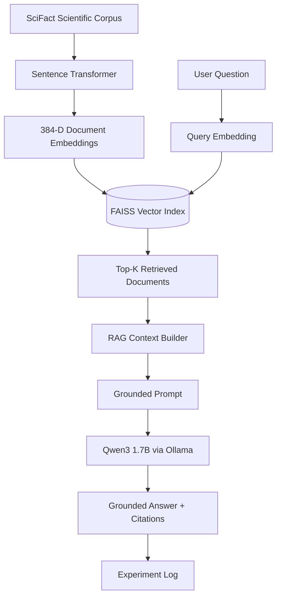

# Scalable RAG with Apache Spark

A research-oriented project exploring **Retrieval-Augmented Generation (RAG) over increasingly large document collections**, progressing from local semantic retrieval to scalable data processing with Apache Spark.

The project is being developed incrementally so that retrieval quality, generation quality, latency, and scalability can be measured at each stage.

> **Current status:** V2 completed — local end-to-end RAG using SciFact, Sentence Transformers, FAISS, Ollama, and Qwen3.

---

## Project Motivation

Retrieval-Augmented Generation combines information retrieval with Large Language Models (LLMs) so that generated answers can be grounded in external evidence.

A conventional RAG pipeline works well for relatively small document collections:

```text
Documents
    ↓
Embeddings
    ↓
Vector Index
    ↓
Retrieval
    ↓
LLM
    ↓
Answer
```

This project asks a broader systems-oriented question:

> **How can RAG pipelines be designed and evaluated as document collections grow from thousands to millions of documents?**

The project begins with a reproducible local baseline and will progressively introduce larger datasets, distributed processing, Apache Spark, and scalability experiments.

---

# Current Architecture



The current implementation runs completely locally.

---

# Project Evolution

## V1.0 — Semantic Retrieval Baseline

V1 established the retrieval component independently of an LLM.

### Pipeline

```text
SciFact
   ↓
all-MiniLM-L6-v2
   ↓
384-dimensional embeddings
   ↓
FAISS
   ↓
Top-K semantic retrieval
   ↓
Recall@K evaluation
```

### Dataset

The initial benchmark uses **SciFact**.

Current local dataset statistics:

| Item | Count |
|---|---:|
| Corpus documents | 5,183 |
| Queries loaded | 1,109 |
| Queries evaluated in baseline | 300 |

SciFact provides relevance judgments, allowing retrieval effectiveness to be measured rather than evaluated only by visual inspection.

### Embedding Model

V1 uses:

```text
sentence-transformers/all-MiniLM-L6-v2
```

Each document is represented as a:

```text
384-dimensional dense vector
```

### Vector Search

Document embeddings are indexed using **FAISS**.

Queries are embedded using the same Sentence Transformer model and compared with document vectors using dense semantic similarity.

### V1 Baseline Result

| Metric | Result |
|---|---:|
| Documents indexed | 5,183 |
| Embedding dimension | 384 |
| Queries evaluated | 300 |
| Top-K | 5 |
| **Recall@5** | **0.7533** |

A Recall@5 of `0.7533` means that for approximately **75.3% of evaluated queries**, at least one SciFact-relevant document appeared among the five retrieved documents.

This metric measures **retrieval effectiveness**, not final RAG answer accuracy.

### Local Indexing Observation

On the initial CPU-based development machine, embedding and indexing the 5,183-document SciFact corpus took approximately:

```text
7 minutes 54 seconds
```

This measurement motivates later scalability experiments with larger datasets and distributed processing.

---

# V2.0 — Local Retrieval-Augmented Generation

V2 extends the V1 retriever into a complete RAG pipeline.

### V2 Pipeline

```text
Question
   ↓
Query Embedding
   ↓
FAISS Retrieval
   ↓
Top-5 Scientific Documents
   ↓
Context Construction
   ↓
Grounded Prompt
   ↓
Local LLM
   ↓
Answer + Citations
```

### Local LLM

V2 uses:

```text
Qwen3 1.7B
```

served locally through:

```text
Ollama
```

This allows the complete RAG pipeline to run without a paid hosted LLM API.

The LLM is responsible only for **generation**.

Retrieval remains a separate component:

```text
Sentence Transformer + FAISS
```

This separation makes it possible to independently evaluate retrieval and generation.

---

## Grounding Strategy

The retrieved documents are converted into numbered evidence blocks:

```text
[1]
Document ID: ...
Title: ...
Evidence: ...

[2]
Document ID: ...
Title: ...
Evidence: ...
```

The LLM is instructed to:

1. Answer using only the retrieved evidence.
2. Avoid unsupported claims.
3. Cite evidence using `[1]`, `[2]`, etc.
4. Explicitly report when the retrieved evidence is insufficient.
5. Provide a concise answer and explanation.

---

# Example V2 RAG Query

### Question

```text
Does vitamin D reduce the risk of multiple sclerosis?
```

### Top Retrieved Evidence

The highest-ranked document was:

```text
Vitamin D and latitude as environmental factors in multiple sclerosis
```

with similarity:

```text
0.7421
```

Other retrieved evidence included literature concerning vitamin D, sun exposure, and multiple sclerosis.

### Generated Answer

The local Qwen3 model produced a grounded response indicating that the retrieved evidence suggests a possible association between vitamin D and reduced multiple-sclerosis risk while also noting that the evidence was insufficient to establish a precise causal relationship.

The generated response included numbered citations corresponding to the retrieved SciFact documents.

### Initial Generation Performance

| Component | Result |
|---|---:|
| LLM | Qwen3 1.7B |
| Runtime | Ollama |
| Hardware | Local CPU |
| Top-K | 5 |
| Generation time | **84.31 seconds** |

The relatively high latency provides another baseline for future hardware and model comparisons.

---

# Technology Stack

| Component | Technology |
|---|---|
| Language | Python 3.11 |
| Dataset | SciFact |
| Embeddings | Sentence Transformers |
| Embedding model | all-MiniLM-L6-v2 |
| Vector index | FAISS |
| Local LLM runtime | Ollama |
| Generator | Qwen3 1.7B |
| Experiment logging | CSV / JSONL |
| Future distributed processing | Apache Spark / PySpark |

---

# Repository Structure

```text
scalable-rag-spark/
│
├── README.md
├── LICENSE
├── requirements.txt
├── .env.example
├── .gitignore
│
├── data/
│   └── index/
│
├── docs/
│   ├── architecture.md
│   ├── rag-concepts.md
│   ├── rag-v2.md
│   └── research-questions.md
│
├── results/
│   ├── baseline_retrieval.txt
│   ├── experiments.csv
│   └── rag_runs.jsonl
│
└── src/
    ├── config.py
    ├── load_scifact.py
    ├── build_index.py
    ├── retrieve.py
    ├── evaluate_retrieval.py
    └── rag.py
```

Generated vector-index files under `data/index/` are not intended to be committed to Git. They can be reproduced using the indexing pipeline.

---

# Running the Project

## 1. Create a Virtual Environment

Windows:

```powershell
py -3.11 -m venv .venv
& ".\.venv\Scripts\Activate.ps1"
```

Install dependencies:

```powershell
pip install -r requirements.txt
```

---

## 2. Load SciFact

```powershell
python src\load_scifact.py
```

Expected corpus size:

```text
Corpus documents: 5,183
Queries: 1,109
Qrels: 339
```

---

## 3. Build the FAISS Index

```powershell
python src\build_index.py
```

This generates document embeddings and builds the local FAISS index.

---

## 4. Test Semantic Retrieval

```powershell
python src\retrieve.py
```

Enter a scientific query when prompted.

---

## 5. Evaluate Retrieval

```powershell
python src\evaluate_retrieval.py
```

Evaluation results are recorded under:

```text
results/
```

including:

```text
baseline_retrieval.txt
experiments.csv
```

---

# Running V2 RAG

## Install Ollama

Install Ollama for your operating system and verify:

```powershell
ollama --version
```

Pull the current local model:

```powershell
ollama pull qwen3:1.7b
```

Verify:

```powershell
ollama list
```

---

## Configure the Project

Create a local `.env` file based on:

```text
.env.example
```

For local generation:

```env
LLM_PROVIDER=ollama
OLLAMA_MODEL=qwen3:1.7b
OLLAMA_URL=http://localhost:11434
```

The `.env` file is excluded from Git and should not be committed.

---

## Run RAG

```powershell
python src\rag.py
```

The system will:

1. Accept a question.
2. Embed the question.
3. Retrieve the Top-K SciFact documents.
4. Construct the RAG context.
5. Send the grounded prompt to the local LLM.
6. Return an answer with source citations.
7. Log the run.

RAG runs are recorded in:

```text
results/rag_runs.jsonl
```

---

# Experiment Tracking

Retrieval experiments are stored in:

```text
results/experiments.csv
```

Current baseline:

```text
Dataset: SciFact
Embedding model: all-MiniLM-L6-v2
Embedding dimension: 384
Vector index: FAISS
Top-K: 5
Queries evaluated: 300
Recall@5: 0.7533
```

RAG generation runs are stored separately in:

```text
results/rag_runs.jsonl
```

This allows retrieval and generation experiments to be analyzed independently.

---

# Planned Experiments

## Retrieval

Future experiments will investigate:

- Recall@1
- Recall@3
- Recall@5
- Recall@10
- Recall@20
- Alternative embedding models
- Chunking strategies
- Hybrid retrieval
- Reranking

---

## RAG Quality

Generation experiments will investigate:

- Citation correctness
- Evidence faithfulness
- Unsupported claims
- Insufficient-evidence behavior
- Prompt design
- Top-K effects
- Generation latency

---

## Model Comparison

Future versions may compare:

```text
Local small LLM
      vs.
Larger local LLM
      vs.
Hosted LLM
```

using:

- answer quality
- groundedness
- latency
- resource usage
- cost

---

# Scaling Roadmap

The project intentionally begins with a small benchmark before introducing distributed infrastructure.

```text
V1
SciFact + FAISS Retrieval
        ↓
V2
Local RAG
        ↓
V3
RAG Evaluation & Retrieval Experiments
        ↓
V4
TREC-COVID (~171K documents)
        ↓
V5
Apache Spark / PySpark
        ↓
V6
MS MARCO subsets
100K → 1M passages
        ↓
V7
Large-scale distributed RAG experiments
```

The objective is to identify **when and where distributed data processing becomes beneficial**, rather than introducing Spark before the workload requires it.

---

# Research Questions

The broader project investigates questions such as:

- How does retrieval effectiveness change as corpus size increases?
- How do embedding and indexing costs scale with document volume?
- When does single-machine preprocessing become a bottleneck?
- How can Apache Spark improve RAG ingestion and embedding pipelines?
- How should large embedding collections be partitioned and indexed?
- What trade-offs exist between retrieval quality, latency, and cost?
- How does Top-K affect RAG groundedness and answer quality?
- How reliably do LLM citations correspond to retrieved evidence?
- How do local and hosted LLMs compare for RAG workloads?

---

# Version History

## v1.0 — Semantic Retrieval

Completed:

- SciFact loading
- Sentence Transformer embeddings
- FAISS indexing
- Semantic search
- Recall@K evaluation
- Experiment logging

Baseline:

```text
Recall@5 = 0.7533
```

---

## v2.0 — Local RAG

Completed:

- Context construction
- Grounded prompting
- Local LLM generation
- Ollama integration
- Qwen3 1.7B integration
- Numbered source citations
- RAG run logging

Initial generation:

```text
84.31 seconds
```

on the initial CPU-only development machine.

---

# Future Direction: Apache Spark

The eventual focus of this project is not simply building another RAG application.

The longer-term objective is to investigate:

> **Scalable RAG data pipelines for large document collections using distributed data processing.**

Future versions will introduce Apache Spark for:

- distributed document ingestion
- text preprocessing
- chunk generation
- embedding pipelines
- batch processing
- scalability experiments

The resulting distributed architecture will conceptually evolve toward:

```text
Large Document Collection
          ↓
     Apache Spark
          ↓
Distributed Preprocessing
          ↓
Distributed Chunking
          ↓
Embedding Generation
          ↓
Vector Index
          ↓
Retrieval
          ↓
RAG
          ↓
LLM
```

---

# Project Context

This project is part of **Big Data & AI Systems**, a collection of research and open-source projects exploring:

- Big Data
- Distributed Data Processing
- Cloud Computing
- Data Engineering
- AI-Powered Data Systems
- Retrieval-Augmented Generation
- Vector Search
- LLM-Powered Analytics

Organization:

**https://github.com/BigDataAISystems**

---

# Author

**Mahdi Ebrahimi, Ph.D.**  
Associate Professor of Computer Science  
California State University, Northridge (CSUN)

Research interests include **Big Data, large-scale data systems, cloud computing, distributed data processing, optimization, and AI-powered data systems**.

Academic website:

**https://mebrahimii.github.io**

---

# License

This project is released under the **MIT License**.

See:

```text
LICENSE
```

for details.