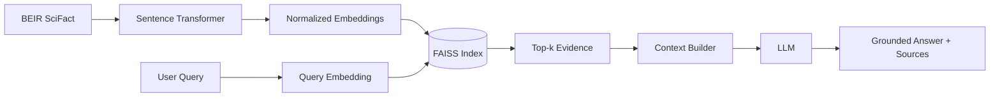

# Architecture

## Version 1: local baseline

## Planned scale path

V1 establishes a transparent non-Spark baseline. Later versions introduce TREC-COVID, local PySpark preprocessing, MS MARCO subsets, distributed embedding/indexing experiments, and finally a distributed environment such as Databricks.
